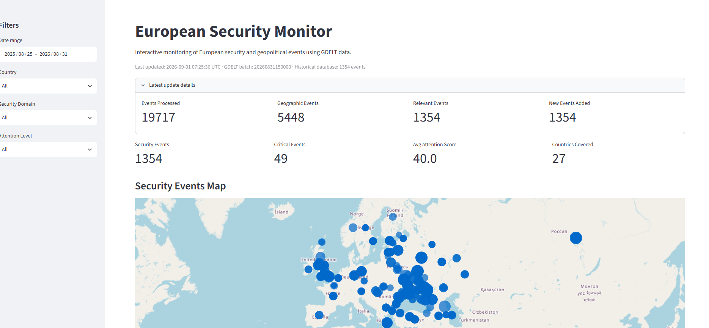
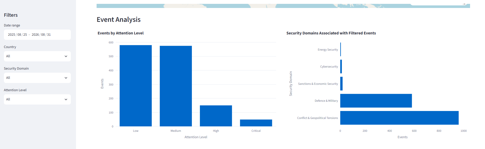
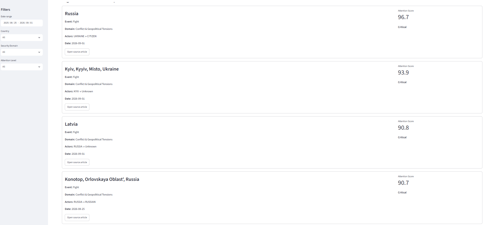

# European Security Monitor — Educational Demo

A **public portfolio project** demonstrating data acquisition, lightweight topic tagging, SQLite persistence, and an interactive Streamlit dashboard for exploring European security-related news.

This repository is a **self-contained educational edition**, not an operational intelligence platform. It illustrates Python data engineering and dashboard design using public news metadata.

## Screenshots of the original exploratory dashboard

The following screenshots document an earlier experimental UI; they are **historical illustrations**, not a representation of the simplified implementation below.





## What the public demo does

1. Queries the public **GDELT DOC 2.0** endpoint for recent news metadata.
2. Normalizes basic fields and stores article records in a local **SQLite** database.
3. Assigns a **simple keyword-based topic label** for classroom demonstration (not a risk assessment).
4. Displays saved records in a basic **Streamlit** interface.

The example focuses on general-purpose programming techniques. Its keyword labels are intentionally elementary, are not verified facts, and should not be relied upon for decision-making.

## Repository layout

- `src/update_data.py` — bounded GDELT API fetch, normalization and SQLite updates.
- `src/article_security_classifier.py` — transparent introductory topic tagging.
- `src/run_monitor.py` — optional periodic local refresh.
- `app/app.py` — simple interactive dashboard.
- `notebooks/01_api_exploration.ipynb` — clean introductory exploration.
- `docs/` — historical project screenshots.

## Getting started

Requires Python 3.10+.

```bash
git clone https://github.com/pedrom40053-afk/european-security-monitor.git
cd european-security-monitor
python -m venv .venv
python -m pip install -r requirements.txt
python src/update_data.py
python -m streamlit run app/app.py
```

On Windows, activate the virtual environment with `.venv\Scripts\Activate.ps1` before installing dependencies; on Linux/macOS use `source .venv/bin/activate`.

The updater uses the public GDELT service; requests may fail or be rate-limited. The dashboard works with locally saved records and will explain when no data has been collected yet.

## Scope, licensing and responsible use

This code is presented as an educational portfolio artifact. The included methods are **basic examples**, not proprietary implementation details, and do not represent any separate private or commercial product. No production credentials, client data, operational workflows, or private configurations are included.

Third-party news articles and data remain subject to their respective owners' terms. Query results may contain inaccurate, incomplete, duplicated or biased metadata. This example does not verify reporting or provide security advice.

The repository is independent and is not affiliated with GDELT, any governmental institution, or any defence or intelligence organisation.

## Technical skills demonstrated

Python · HTTP APIs · JSON · SQLite · data normalization · pandas · Streamlit · data visualization · error handling.

**Note about version history:** Git preserves past public commits. Removing material from the latest revision does not make previously published revisions inaccessible.